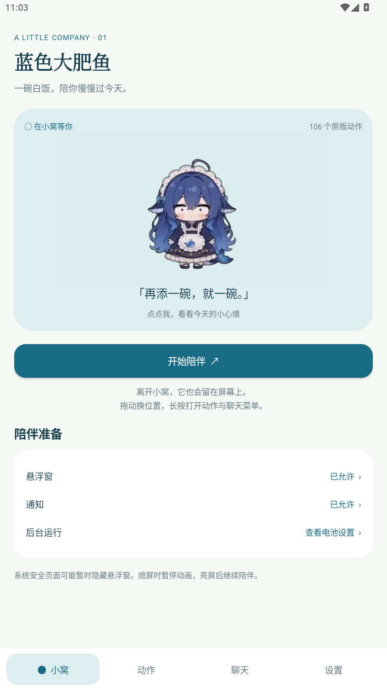
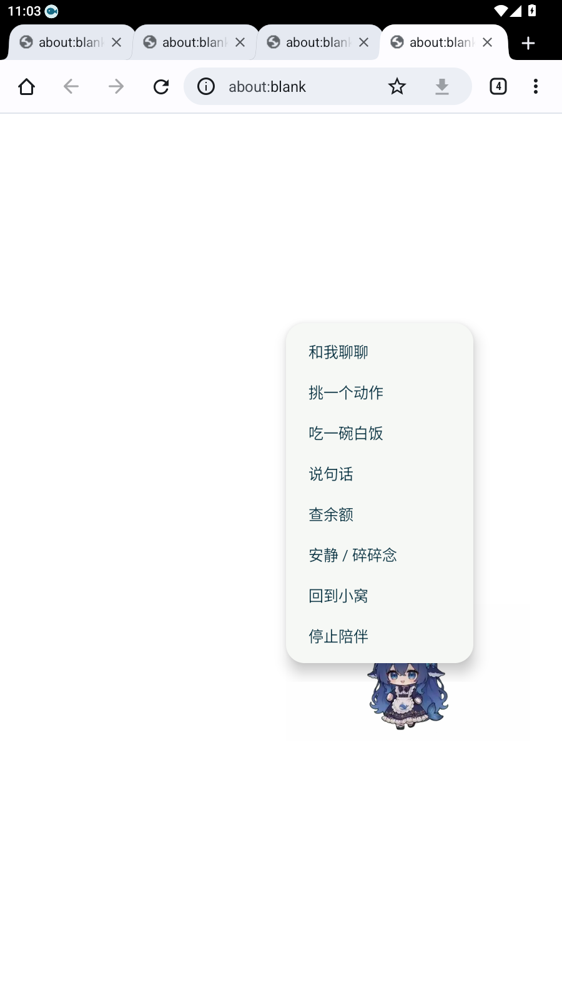
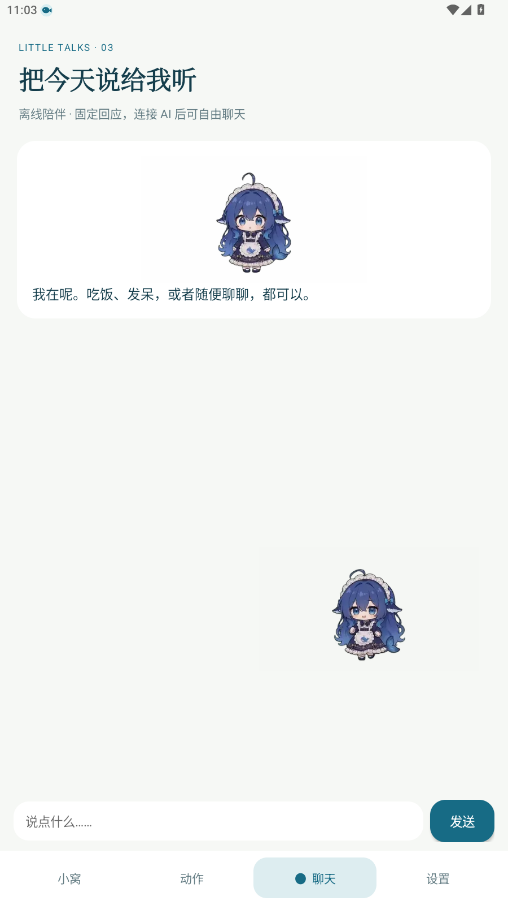

# 功能对应与验收

验收日期：2026-10-24。应用版本 0.1.0，包名 `com.lanse.fish`。

后续用户真机反馈：左右拖动受透明画布限制，长按菜单过大，点播跳回App，自动动作不够丰富。本文保留0.1.0当时的检查记录，**不将这些检查视为上述问题已解决**。本轮仅形成[下一候选版方案与验收表](0.1.1/蓝色大肥鱼_现版优化方案与验收.md)，未修改APK。

## 本版对应关系

| 原版能力 / 手机需求 | Android 0.1.0 |
| --- | --- |
| 原版动作与表情 | 106 段完整动画、27 张表情，全部随包提供；透明 WebP 为 480×270，保留原始时间线 |
| 手机桌面与其他应用上方显示 | 系统悬浮窗 + 前台服务；权限授权后启动；系统安全界面可能隐藏 |
| 点击、长按菜单、拖动、甩动、走动 | 已提供触屏交互与边界处理 |
| 动作库、吃饭/睡眠时段、碎碎念 | 已提供；可手动点播及关闭自动行为 |
| 多只宠物、大小、位置、不透明度 | 1–3 只，共用人设和服务连接，可固定位置 |
| AI 对话、上下文、人设 | 支持独立 OpenAI 兼容服务及 DSH；未配置时明确显示离线固定回应 |
| 聊天记录 | 手机本机最近 100 轮，JSON 导出/清空；发送上下文可配置 0–50 轮 |
| 余额、工作状态、气泡 | DeepSeek 官方余额；DSH 余额三类格式、六档工作状态、文字气泡、内置动作点播 |
| 后台与停止 | 通知栏停止、熄屏暂停、可选重启恢复；仍受 Android 和厂商后台策略约束 |
| Electron 托盘、多显示器、电脑端插件安装管理 | 未作为 Android 本地能力复制 |
| 第三方插件锁、动态菜单、播放回执、外部动画 URL、自定义素材导入 | 本版未提供 |
| QQ/OneBot 互通 | 本版未连接，DSH 连接不等于 QQ 机器人连接 |

## 已完成验证

| 验证项 | 证据与结果 |
| --- | --- |
| 固定来源 | [PC2005-cloud/dsh-pet](https://github.com/PC2005-cloud/dsh-pet) v0.3.8，提交 `593b9b0785f883630243ef6213542f4603ef69ad`；对照上游目录共106个动画文件。代码MIT，素材另有禁止商用及署名要求，见[第三方说明](../THIRD_PARTY_NOTICES.md) |
| 资源完整性 | 106 段、27 张表情、24,354 帧；原视频 SHA-256、转换文件 SHA-256、透明通道、逐帧解码及对应原始时长均通过 |
| Android 设备测试 | 独立 MuMu 模拟器，Android 15 / API 35，346 项检查通过 |
| 动画显示 | 全部 106 段由 Android ImageDecoder 解码为 AnimatedImageDrawable，有可见像素及透明背景；覆盖解码先于窗口附加的情况 |
| 悬浮生命周期 | 单只窗口、三只窗口、刷新回单只、停止后零窗口；Home 后前台服务继续运行 |
| 连接与数据 | Keystore 凭据加密；不安全 URL 拒绝；真实本机 HTTP fixture 验证独立 AI 对话/模型列表、DSH 对话/状态、鉴权失败无伪造回复 |
| DSH 可选桥接器 | 令牌鉴权、路由白名单、浏览器 Origin 拒绝、转发不携带桥接令牌、请求体限制均通过 |
| 发行包 | Release 构建成功，Android lint 为 0 错误、7 警告；APK v2 签名验证通过 |
| 正式签名包安装与操作 | 安装成功；桌面和另一浏览器应用上方显示、拖动、长按菜单、进入聊天、离线标识、熄屏恢复、显式停止均通过 |

lint 警告涉及 SDK 版本更新提示、旧系统备份配置建议、触摸处理的静态可访问性检查和左右布局建议。没有把警告描述为全部消失。拖动点击路径已调用 `performClick`；非聚焦悬浮菜单的文字无法由该模拟器普通 `uiautomator dump` 提取，使用窗口验证、真实点击及截图核对。

开发侧未连接用户真机调试；用户已安装并反馈上述体验问题。Android 9–14 和 16 尚未逐版本运行测试。实际 AI 账户及真实 DSH 服务尚未配置；HTTP 测试服务通过不代表用户账户已连通。未做多天续航、所有厂商后台策略或真实重启后的自动恢复保证。

## 可复核材料

本机 `output/` 下保留 `asset-checks.json`、`device-tests.txt`、`bridge-tests.txt`、`ui-smoke.txt`、`build-release.log`、`signature-check.txt`、`SHA256SUMS.txt` 和正式 APK。它们是生成产物，不提交到 Git；公开信息的摘要在本文，正式 APK 和校验文件放仓库 Release。

发行证书 SHA-256 指纹：`5be09c6129ca809f1784576d76f6407a8c5949075e2d25693baacb5dff4282ee`。

APK SHA-256：`89981fc8274d5f3dd3d198b8c801cac74bf832c185c7414112f88731c6e389fa`。

以下为专用测试模拟器截图：

| 应用首页 | 跨浏览器悬浮菜单 | 聊天入口 |
| --- | --- | --- |
|  |  |  |
